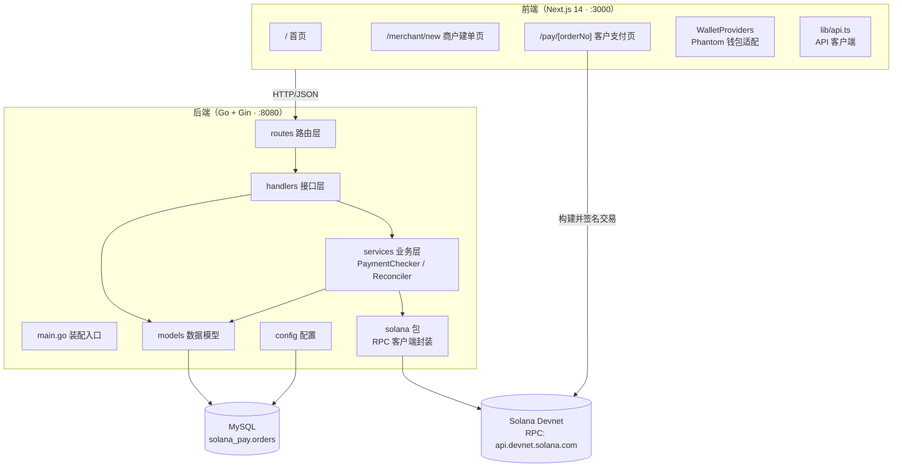
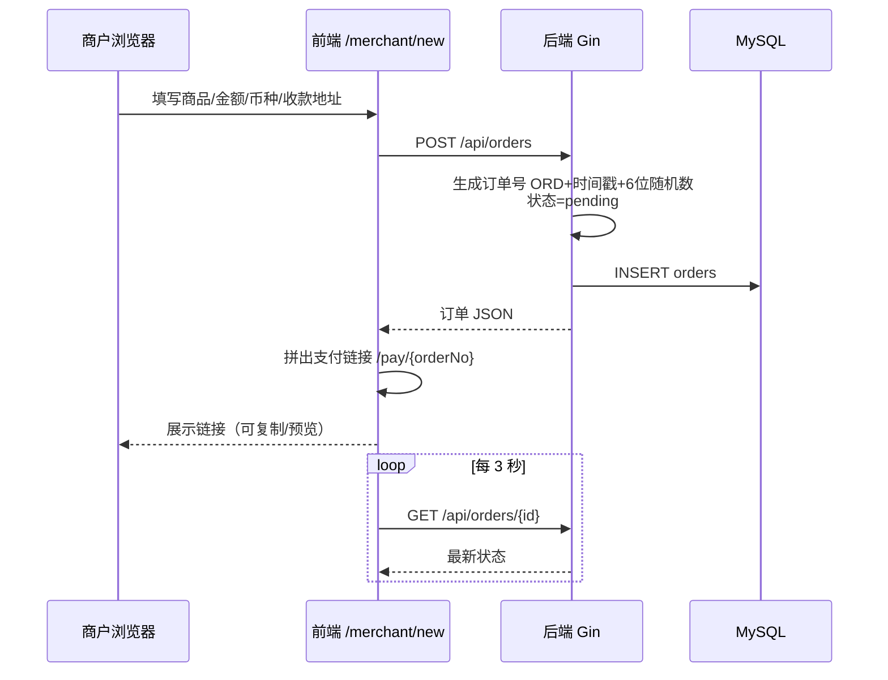
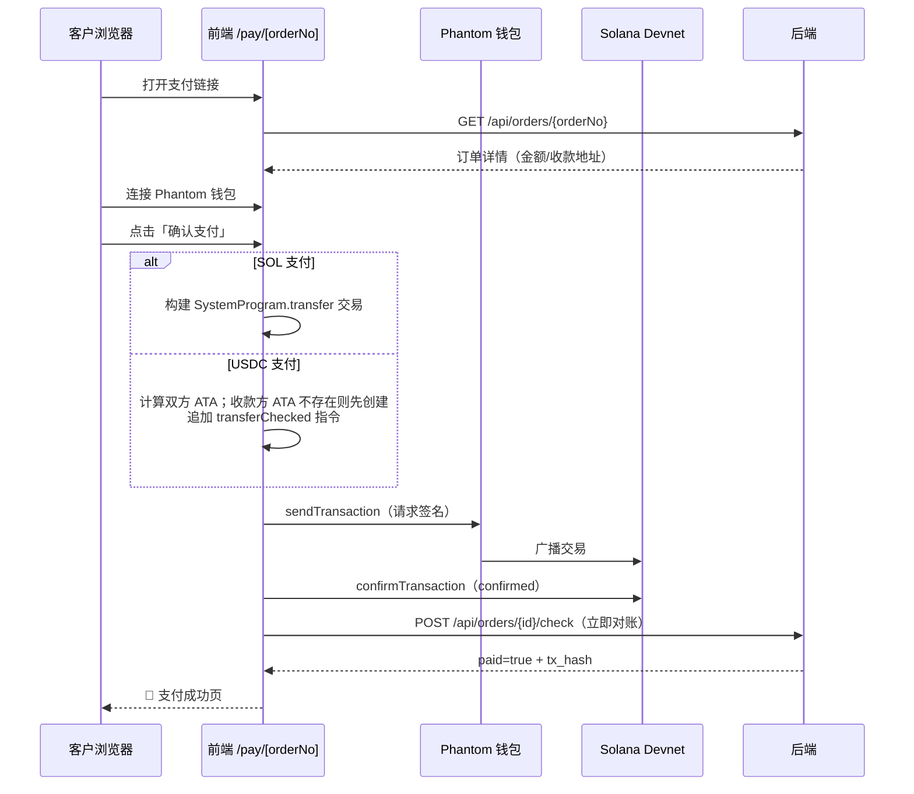
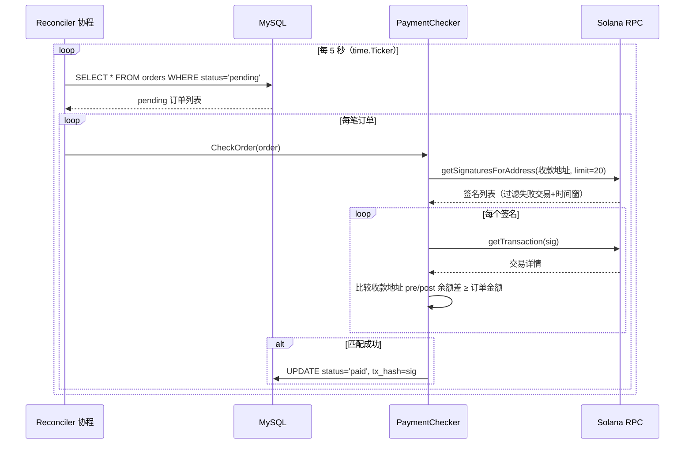

# 01 · 整体架构

## 1.1 架构总览

系统采用经典的**前后端分离 + 链上数据源**三层结构：



**关键认知**：后端**不参与签名、不托管私钥**。支付交易完全由前端用客户钱包构建并直接上链；后端只做「读链」——通过公开 RPC 核对收款地址的入账记录，再回写订单状态。这是一个典型的**只读链上监听（watch-only）**架构。

## 1.2 技术栈

| 层 | 技术 | 版本 | 用途 |
|----|------|------|------|
| 后端语言 | Go | 1.25.5（go.mod） | 服务实现 |
| Web 框架 | Gin | v1.10.0 | HTTP 路由/中间件 |
| 跨域 | gin-contrib/cors | v1.7.2 | 放行 :3000 前端 |
| ORM | GORM + MySQL 驱动 | v1.25.11 / v1.5.7 | 订单持久化 |
| 链交互 | gagliardetto/solana-go | v1.12.0 | RPC 调用、交易解析 |
| 前端框架 | Next.js（App Router） | 14.2.5 | 页面与服务端渲染 |
| UI | React 18 + Tailwind CSS 3.4 | — | 界面 |
| 钱包 | @solana/wallet-adapter 系列 | — | Phantom 连接/签名 |
| 链 SDK | @solana/web3.js + spl-token | 1.95.3 / 0.4.15 | 构建 SOL/USDC 交易 |

## 1.3 后端内部分层与依赖方向

```
main.go（组装）
   │
   ├──► config ──► *gorm.DB（MySQL 连接池）
   │
   ├──► models ──► AutoMigrate 建表
   │
   ├──► solana ──► *RPCClient（HTTP RPC 客户端）
   │
   ├──► services.PaymentChecker（db + rpc）
   │         ▲
   ├──► services.Reconciler（db + checker，5s ticker 协程）
   │         │
   └──► routes ──► handlers.OrderHandler（db + checker）
```

依赖方向严格向下：`routes → handlers → services → solana/models`，无循环依赖。`main.go` 是唯一知道全部组件的「组合根（Composition Root）」。

## 1.4 核心业务流程

### 1.4.1 商户建单流程



### 1.4.2 客户支付流程（前端直连链）



### 1.4.3 后台自动对账循环



手动对账接口 `POST /api/orders/:id/check` 与上述循环复用同一个 `PaymentChecker.CheckOrder`，区别只是触发方式（HTTP 请求 vs 定时器）。

## 1.5 关键设计要点

### 对账匹配策略
- **余额差值法**：不解析 Transfer 指令本身，而是比较交易中收款地址的 `PreBalances` / `PostBalances` 差值。差值 > 0 即视为该笔交易向收款方转入了对应 lamports。这是实施计划中明确的「兜底方案」——比解析指令更简单，覆盖普通 SOL 转账场景。
- **硬匹配条件**（全部满足才判 paid）：
  1. 交易成功（`Meta.Err == nil` 且签名本身无错误）；
  2. 交易时间 ≥ 订单创建时间 − 2 分钟（时间窗口，避免把历史入账误匹配给新订单）；
  3. 收款地址出现在交易账户列表且余额净增加；
  4. 净增加 lamports ≥ 订单金额换算的 lamports（允许超额支付）。
- **精度处理**：订单金额以**字符串**存储（如 `"0.01"`），对账时用 `big.Float` 解析后乘以 `1e9` 转为 `big.Int` lamports 比较，避免浮点误差。

### 并发与健壮性
- `Reconciler` 在独立 goroutine 中运行，`runOnce()` 带 `recover()`，单轮 panic 不会杀死对账循环；单笔订单对账出错只记日志并继续下一笔。
- HTTP 服务与对账协程共享同一个 `*gorm.DB`（内部连接池：MaxIdle=10 / MaxOpen=100）和同一个 `PaymentChecker`（无状态，天然并发安全）。

### CORS
仅放行 `http://localhost:3000` 与 `http://127.0.0.1:3000`，允许携带凭证，预检缓存 12 小时。

## 1.6 已知限制（重要）

| 限制 | 说明 | 位置 |
|------|------|------|
| **USDC 无法自动对账** | `PaymentChecker.CheckOrder` 对非 SOL 币种直接返回未支付。前端虽能完成 USDC 转账，但订单永远不会自动变 `paid` | services/payment_checker.go |
| 匹配存在理论误判 | 同一收款地址、时间窗内、金额≥订单额的**任意**入账都会命中（未用 Memo/参考地址区分订单） | services/payment_checker.go |
| `expired` 状态未使用 | 状态机定义了 `expired`，但代码中没有任何过期逻辑写入该状态 | models/order.go |
| 无鉴权 | 所有 API 公开可访问，商户页/支付页无登录体系 | routes/routes.go |
| 公开 RPC 限速 | 默认 `api.devnet.solana.com` 有速率限制，高频轮询场景需换付费 RPC | solana/rpc_client.go |
| 软删除字段未用 | `DeletedAt` 存在但无删除接口 | models/order.go |
