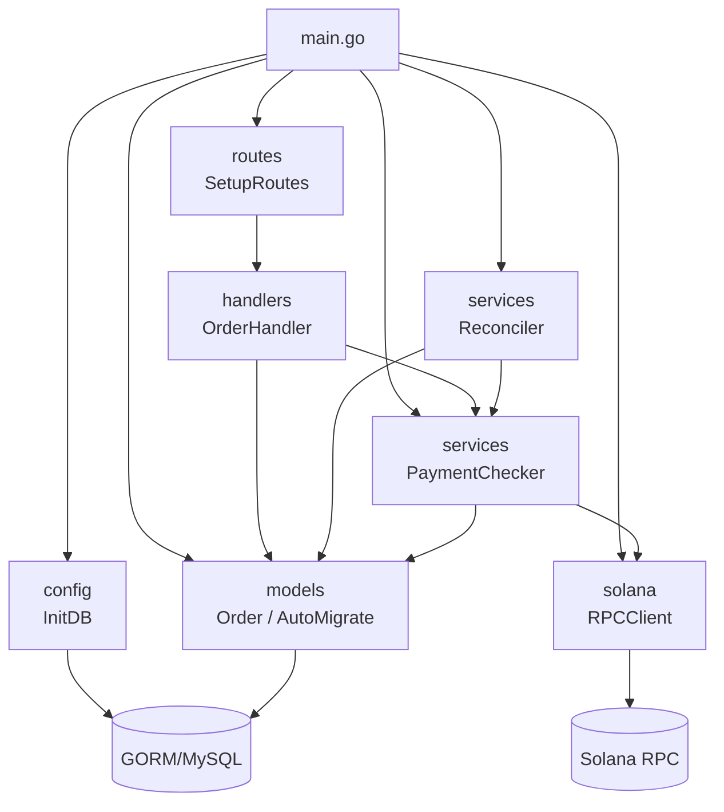

# 02 · 后端模块详解

Go module 名：`solana-pay`。后端共 7 个包/文件，职责自下而上分层。

## 2.1 `main.go` — 程序入口 / 组合根

文件：`main.go`

唯一的 `main` 包，负责按顺序装配所有组件：

| 步骤 | 调用 | 失败行为 |
|------|------|----------|
| 1. 连接数据库 | `config.InitDB()` | `log.Fatalf` 退出 |
| 2. 自动建表 | `models.AutoMigrate(db)` | `log.Fatalf` 退出 |
| 3. 初始化链上客户端 | `solanarpc.NewRPCClient()` | `log.Fatalf` 退出 |
| 4. 组装对账服务 | `services.NewPaymentChecker(db, rpcClient)` → `services.NewReconciler(db, checker, 5s)` | — |
| 5. 启动后台对账 | `go reconciler.Start()`（独立 goroutine） | — |
| 6. 配置 HTTP | `gin.Default()` + CORS 中间件 | — |
| 7. 注册路由 | `routes.SetupRoutes(r, db, checker)` | — |
| 8. 监听 | `r.Run(":8080")` | `log.Fatalf` 退出 |

**CORS 配置**：仅允许 `http://localhost:3000` 与 `http://127.0.0.1:3000` 来源；允许方法 GET/POST/PUT/PATCH/DELETE/OPTIONS；`AllowCredentials: true`；预检缓存 12 小时。

---

## 2.2 `config` 包 — 数据库配置

文件：`config/config.go`

### 类型

```go
type DBConfig struct {
    User     string
    Password string
    Host     string
    Port     string
    DBName   string
}
```

### 函数

| 函数 | 签名 | 说明 |
|------|------|------|
| `LoadDBConfig` | `func LoadDBConfig() DBConfig` | 从环境变量读取配置，缺省回落到默认值（见下表） |
| `InitDB` | `func InitDB() (*gorm.DB, error)` | 拼接 DSN → `gorm.Open(mysql...)` → 设置连接池（MaxIdle=10，MaxOpen=100）→ 返回 `*gorm.DB` |

### 环境变量与默认值

| 环境变量 | 默认值 |
|----------|--------|
| `DB_USER` | `root` |
| `DB_PASSWORD` | `root123` |
| `DB_HOST` | `127.0.0.1` |
| `DB_PORT` | `3306` |
| `DB_NAME` | `solana_pay` |

DSN 固定参数：`charset=utf8mb4&parseTime=True&loc=Local`。

---

## 2.3 `models` 包 — 数据模型

文件：`models/order.go`

### 状态枚举 `OrderStatus`

| 常量 | 值 | 含义 | 备注 |
|------|-----|------|------|
| `StatusPending` | `"pending"` | 待支付 | 创建时的默认状态 |
| `StatusPaid` | `"paid"` | 已支付 | 对账成功后写入，同时写入 `TxHash` |
| `StatusExpired` | `"expired"` | 已过期 | **已定义但代码中无写入逻辑** |

### 结构体 `Order`（对应表 `orders`）

| 字段 | Go 类型 | GORM 标签 | 说明 |
|------|---------|-----------|------|
| `ID` | `uint` | `primaryKey` | 自增主键 |
| `OrderNo` | `string` | `uniqueIndex;size:64;not null` | 商户订单号，全局唯一，用于支付链接 |
| `ProductName` | `string` | `size:255;not null` | 商品/服务名称 |
| `Amount` | `string` | `size:32;not null` | 金额（**字符串存储**，避免浮点精度问题） |
| `Currency` | `string` | `size:16;not null` | 币种：`SOL` / `USDC` |
| `ReceiverAddress` | `string` | `size:128;not null` | 商户收款钱包地址（Base58） |
| `Status` | `OrderStatus` | `size:16;not null;default:pending` | 订单状态 |
| `TxHash` | `string` | `size:256` | 支付交易哈希，omitempty |
| `CreatedAt` | `time.Time` | — | 创建时间（对账时间窗基准） |
| `UpdatedAt` | `time.Time` | — | 更新时间 |
| `DeletedAt` | `gorm.DeletedAt` | `index` | 软删除标记（JSON 不输出） |

### 函数

| 函数 | 签名 | 说明 |
|------|------|------|
| `AutoMigrate` | `func AutoMigrate(db *gorm.DB) error` | 对 `Order` 执行 GORM 自动迁移（只增不改不删） |
| `GenerateOrderNo` | `func GenerateOrderNo() string` | 生成订单号：`ORD` + `yyyyMMddHHmmss` + 6 位随机数，如 `ORD20261010143052123456` |

> 包级 `init()` 中执行 `rand.Seed(...)` 初始化随机种子。

---

## 2.4 `routes` 包 — 路由注册

文件：`routes/routes.go`

唯一函数：

```go
func SetupRoutes(r *gin.Engine, db *gorm.DB, checker *services.PaymentChecker)
```

内部构造 `handlers.NewOrderHandler(db, checker)` 并注册路由：

| 方法 | 路径 | 处理函数 | 说明 |
|------|------|----------|------|
| GET | `/api/ping` | 匿名函数 | 健康检查，返回 `{"message":"pong"}` |
| POST | `/api/orders` | `OrderHandler.CreateOrder` | 创建订单 |
| GET | `/api/orders/:id` | `OrderHandler.GetOrder` | 查询订单（`:id` 支持主键 ID 或 order_no） |
| POST | `/api/orders/:id/check` | `OrderHandler.ManualCheckOrder` | 手动触发对账 |

---

## 2.5 `handlers` 包 — HTTP 接口层

文件：`handlers/order_handler.go`

### 结构体

```go
type OrderHandler struct {
    db      *gorm.DB
    checker *services.PaymentChecker
}
```

构造函数：`NewOrderHandler(db *gorm.DB, checker *services.PaymentChecker) *OrderHandler`

### 请求体 `CreateOrderRequest`

| 字段 | 校验规则 |
|------|----------|
| `product_name` | `required` |
| `amount` | `required` |
| `currency` | `required` 且必须是 `SOL` 或 `USDC`（`oneof`） |
| `receiver_address` | `required`（不校验是否为合法 Base58 地址） |

### 处理方法

#### `CreateOrder`
1. `ShouldBindJSON` 校验请求体，失败返回 400 + 校验细节；
2. 生成 `OrderNo`，状态置 `pending`，写入数据库；
3. 成功返回 200 + 完整订单 JSON；写库失败返回 500。

#### `GetOrder`
- URL 参数 `:id` 同时按 `id = ? OR order_no = ?` 查询，支持数字主键和订单号两种寻址；
- 未找到返回 404 `{"error":"订单不存在"}`。

#### `ManualCheckOrder`
1. 同 `GetOrder` 的方式定位订单；
2. 若订单**非** `pending`：直接返回当前状态，不再对账（响应带 `paid` 布尔值）；
3. 否则调用 `checker.CheckOrder(&order)` 立即执行链上核对；
4. 核对后重新从数据库读取最新订单返回（响应带 `paid` 布尔值 + 最新订单）。

---

## 2.6 `services` 包 — 业务逻辑层

### 2.6.1 `PaymentChecker`（单笔对账）

文件：`services/payment_checker.go`

```go
type PaymentChecker struct {
    db  *gorm.DB
    rpc *solanarpc.RPCClient
}
```

核心方法：

```go
func (c *PaymentChecker) CheckOrder(order *models.Order) (wasPaid bool, err error)
```

执行逻辑（按顺序）：

1. **守卫**：`order` 为 nil → 报错；订单非 `pending` → 直接按当前状态返回；
2. **币种过滤**：`Currency` 转大写后非 `"SOL"` → **直接返回 `(false, nil)`**（USDC 对账未实现）；
3. **时间窗**：`since = order.CreatedAt - 2分钟`；
4. **查签名**：`rpc.GetRecentSignatures(order.ReceiverAddress, 20, since)` 取收款地址最近 20 笔成功交易；
5. **金额换算**：订单金额字符串 → `big.Float` → ×1e9 → `big.Int` lamports；
6. **逐笔核对**：对每个签名调 `rpc.GetSOLTransferDetails(sig, receiver)`：
   - 交易不存在/失败/收款方无净入账 → 跳过；
   - 净入账 lamports **≥** 订单 lamports → **命中**；
7. **命中处理**：`UPDATE orders SET status='paid', tx_hash=?, updated_at=?`，返回 `(true, nil)`；
8. 全部未命中 → 返回 `(false, nil)`。

### 2.6.2 `Reconciler`（后台定时对账）

文件：`services/reconciler.go`

```go
type Reconciler struct {
    db       *gorm.DB
    checker  *PaymentChecker
    interval time.Duration   // 默认 5s
    stopCh   chan struct{}
}
```

| 方法 | 说明 |
|------|------|
| `NewReconciler(db, checker, interval)` | 构造；`interval <= 0` 时回落到 5 秒 |
| `Start()` | 阻塞式循环：`time.Ticker` 每 interval 触发一轮 `runOnce()`；收到 `stopCh` 信号后退出。由 `main.go` 以 `go reconciler.Start()` 启动 |
| `Stop()` | 关闭 `stopCh`，停止对账循环（当前代码中未被调用） |
| `runOnce()` | **单轮对账**：查询全部 `pending` 订单 → 逐笔调 `checker.CheckOrder` → 统计并打印命中数。带 `defer recover()`，单轮 panic 不影响后续轮次；单笔失败仅记日志并 `continue` |

---

## 2.7 `solana` 包 — 链上 RPC 封装

文件：`solana/rpc_client.go`

### 常量

| 常量 | 值 | 说明 |
|------|-----|------|
| `DefaultRPCURLDevnet` | `https://api.devnet.solana.com` | 默认 RPC 节点（Devnet） |
| `LamportsPerSOL` | `1_000_000_000` | 1 SOL = 10⁹ lamports |

### 结构体与构造函数

```go
type RPCClient struct {
    client *rpc.Client   // gagliardetto/solana-go/rpc
}

func NewRPCClient() (*RPCClient, error)
```

- 读取环境变量 `SOLANA_RPC_URL`，为空则用 Devnet 默认地址；
- `func (r *RPCClient) RPCClient() *rpc.Client` 暴露底层客户端（逃生舱口）。

### 方法 `GetRecentSignatures`

```go
func (r *RPCClient) GetRecentSignatures(address string, limit int, since time.Time) ([]string, error)
```

1. 校验并解析 Base58 地址为公钥；
2. 调 `getSignaturesForAddress`，commitment = **confirmed**，`limit` ≤ 0 时取 20；
3. 过滤：签名本身带错误（`s.Err != nil`）的丢弃；`since` 非零且交易 `BlockTime` 早于 `since` 的丢弃；
4. 返回签名（Base58 字符串）列表。

### 结构体 `SOLTransferInfo`

```go
type SOLTransferInfo struct {
    ReceiverLamports uint64  // 收款方净入账（lamports）
    To               string  // 收款地址
    Success          bool
}
```

### 方法 `GetSOLTransferDetails`

```go
func (r *RPCClient) GetSOLTransferDetails(txHash string, receiverAddr string) (ok bool, info *SOLTransferInfo, err error)
```

1. 解析交易哈希为签名；调 `getTransaction`（编码 base64，commitment confirmed）；
2. 交易不存在 / `Meta.Err != nil` / 交易体解析失败 → 返回 `ok=false`；
3. **余额差值匹配**：校验 `PreBalances`/`PostBalances` 长度与 `AccountKeys` 一致后，遍历账户列表找到 `receiverAddr`，计算 `post - pre`：
   - 差值 > 0 → 返回 `ok=true` 及 `SOLTransferInfo{ReceiverLamports: diff, Success: true}`；
   - 差值 ≤ 0 → 返回 `ok=false`。

> **注意**：该方法不解析具体指令（SystemProgram.Transfer），而是用余额变化兜底——任何导致收款地址余额净增的交易（含转账、账户合并等）都会被算作入账。

---

## 2.8 后端模块间调用关系图


