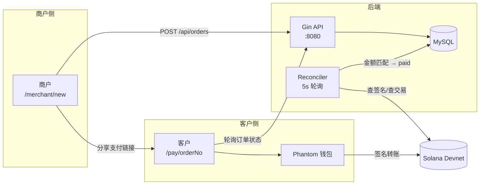

# Solana Pay 项目 Code Wiki

> 面向自由职业者与小商家的 **Solana 链上收款 + 自动对账工具**。
> 商户创建收款订单 → 生成支付链接 → 客户用 Phantom 钱包在 Devnet 付款 → 后端自动轮询链上交易并把订单标记为已支付。

---

## 项目简介

| 项目 | 说明 |
|------|------|
| 项目名 | `solana-pay`（Go module 名）/ `solana-pay-web`（前端包名） |
| 类型 | 全栈 Web 应用（Go 后端 + Next.js 前端） |
| 区块链 | Solana **Devnet**（默认，可通过环境变量切换 RPC） |
| 支持币种 | 前端支付：SOL、USDC；后端自动对账：目前**仅 SOL** |
| 后端端口 | `:8080`（Gin HTTP 服务） |
| 前端端口 | `:3000`（Next.js 开发服务器） |
| 数据库 | MySQL（默认库名 `solana_pay`） |

## 核心能力

1. **商户收款建单**：填写商品名、金额、币种（SOL/USDC）、收款地址，生成唯一订单号与 `/pay/{orderNo}` 支付链接。
2. **客户链上支付**：支付页连接 Phantom 钱包，构建并签名 SOL 转账或 USDC（SPL Token）转账交易。
3. **自动对账**：后台协程每 5 秒扫描所有 `pending` 订单，通过 Solana RPC 核对收款地址的近期交易，金额匹配则标记 `paid` 并记录 `tx_hash`。
4. **手动对账**：提供 `POST /api/orders/:id/check` 接口，支付完成后可立即触发核对，无需等待轮询。

## Wiki 导航

| 文档 | 内容 |
|------|------|
| [01-architecture.md](01-architecture.md) | 整体架构、技术栈、分层设计、支付/对账时序、设计要点与已知限制 |
| [02-backend.md](02-backend.md) | Go 后端各模块（main / config / models / routes / handlers / services / solana）职责与关键函数 |
| [03-frontend.md](03-frontend.md) | Next.js 前端页面、钱包集成、支付交易构建流程 |
| [04-api-reference.md](04-api-reference.md) | REST API 接口参考（请求/响应/错误码/示例） |
| [05-data-model.md](05-data-model.md) | 订单数据模型、字段说明、状态机、订单号规则 |
| [06-dependencies.md](06-dependencies.md) | 前后端依赖清单、模块依赖关系、环境变量 |
| [07-getting-started.md](07-getting-started.md) | 环境准备、启动步骤、端到端验证、常见问题 |

## 仓库结构速览

```
solana/
├── main.go                  # 后端入口：装配 DB / RPC / 对账协程 / HTTP 服务
├── go.mod / go.sum          # Go 依赖（module solana-pay）
├── config/
│   └── config.go            # MySQL 连接配置与初始化
├── models/
│   └── order.go             # Order 数据模型、状态枚举、订单号生成
├── routes/
│   └── routes.go            # Gin 路由注册
├── handlers/
│   └── order_handler.go     # 订单 HTTP 接口（创建/查询/手动对账）
├── services/
│   ├── payment_checker.go   # 单笔订单链上核对逻辑
│   └── reconciler.go        # 后台定时对账协程
├── solana/
│   └── rpc_client.go        # Solana RPC 封装（签名列表 / 交易解析）
├── web/                     # Next.js 14 前端（App Router + TS + Tailwind）
│   └── src/
│       ├── app/             # 页面：首页 / 商户建单 / 客户支付
│       ├── components/      # 钱包 Provider 封装
│       └── lib/             # 后端 API 客户端
└── .trae/documents/         # 项目分步实施计划（历史文档）
```

## 一分钟了解系统


